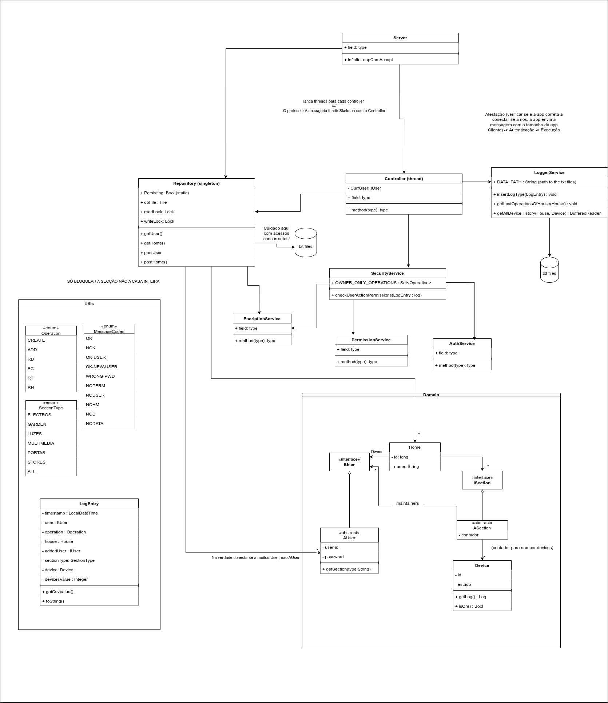

# SegConf-2026

Projeto de Segurança e Confiabilidade

## Group Members

- Guilherme Dias
- Lana Santos
- Sofia Rodrigues

## Overview & Requirements

This project consist in two applications: a server and a client. The server is responsible for managing the state of the system, including users, houses, sections, and devices. The client is a command-line interface that allows users to interact with the server and perform various operations.

This project was developed in both Ubuntu 24.04 LTS and MacOS, any Java version above Java 8 should suffice to compile and run the project, nevertheless the project was developed using Java 21 LTS.

[Go to Usage](#usage)

## Features

- Users: Each user has a unique username, a password, and can create their own houses. Users can also be added as maintainers to other users' houses.
- Houses: Each house has a unique name, an owner (the user who created it), sections (E - Electros, G-Garden, L-Luzes, M-Multimedia, P-Portas, S-Stores). Each section of the house can have maintainers (users who have access to that section). Houses can be created by users and can have multiple sections.
- Devices: Each device has a unique name, a section (e.g., light, door, multimedia), and a state (on - with timer/off). Devices can be added to sections of houses and can be controlled by maintainers of those sections.
- Persistence: Data is persisted to files, ensuring that the state of the repository is maintained across server restarts.
- Logging: All operations are logged with timestamps, user information, and operation details.
- Concurrency: The server can handle multiple client connections simultaneously using a thread pool.
- Graceful Shutdown: The server can be shut down gracefully, ensuring that all ongoing operations are completed before termination.

## Architecture



### File Structure

```plaintext
|data/       --> contains the data that is persisted (by both client and server)
|out/        --> contains the binaries
|src/sperta/ --> contains the code
|.           --> contains scripts and the output jars
```

#### The Code

```plaintext
|domain/  
|      |core/
|      |...                  --> Classes from the Domain (House, Section, User)
|      |controller.java      --> Thread class that controls all domain classes
|services/
|      |LoggerService.java   --> Controlls all logging functionality
|      |Repository.java      --> Layer of access to the persistence, works as an in-memmory database
|      |SecurityService.java --> Holds every Security-related logic (permissions, atestation...)
|utils/                      --> Holds utility classes and abstraction layers
|      |enums...
|      |LogEntry.java        --> Represents an action from client and it's log
|      |Persistence.java     --> Abstracts certain creation and manipulation of files
|SpertaClient.java           --> Runs a client and it's CLI
|SpertaServer.java           --> Runs the server and launches Controller threads
```

#### The Data

```plaintext
|clientFiles/           --> Holds all client files 
|houses/                --> Holds all Houses's log files
|      |Casa_1/         --> Holds all device's logs from Casa_1
|      |      |E/       --> Holds all device's logs from Casa_1 from Section E
|      |      | |E1.csv --> Stores the logs from E1 belonging to section E, from House Casa_1
|      |      |G/
|      |      |L/
|      |      |M/
|      |      |...
|      |Casa_2/
|      |      |...
|attestation.txt        --> After compilation, receives size (in bytes) of SpertaClient's jar size
|homes.txt              --> Contains the natively serialized in-memmory representation of all registered houses
|users.txt              --> Contains the natively serialized in-memmory representation of all registered users
```

##### How is Data stored?

When exiting, SpertaServer safely closes all threads and persisits the HashMaps inside Repository [see file structure](#file-structure). These HashMaps are then serialized (using java's native serialization) and that byte stream is stored in homes.txt and users.txt respectively.
No data is stored while the server is running with the exception of logs. Data is only persisted when the server ends it's execution.

Every time SpertaServer loads, it loads the bytes from these files and creates a backup, in case of malfuncioning, preventing full data-loss.

Logs are managed by LoggerService that is called by a Controller thread that has just executed successfully an operation. All logs are appended to their respective Device's and House's log. If there is no log file, LoggerService creates one. Appending to a text file is safe and reasonably easy and quick and this operation is done as quickly as possible. For this reason, these log files might have slightly incongruent timestamps (in the order of the milliseconds) because, to avoid uneccessary bottlenecks, there are no write locks onto these files.

## Usage

### Building the Project and Starting the Server

To build the project, navigate to the `Sperta` directory and run:
```
bash build.sh
```
It will compile the source code, generating the JAR files for both the server and client. **Also it will also clean the previous data from previous runs** and create a new `data` directory. Finally, it will run the server in the same terminal.

**Important:** This command is to be used for the first time to build the project and start the server. For subsequent runs, you can start the server without rebuilding by using the `server_run.sh` script.

### Starting the Client

To start the client, navigate to the `Sperta` directory and run:
```
bash client_run.sh
```
This will launch the client application, allowing you to interact with the server through the command-line interface.

This scripts launches the default user 'sofia' with password 1234, have that in mind when running multiple clients.

If you want to run the app with a different user run:
```
java -jar SpertaClient.jar localhost <username> <password>
```
If you don't pass neither every argument nor the correct user's password, the server wont establish a connection.

## Limitations and Future Work

- The current implementation does not include the delete operations for users, houses, sections, and devices. Future work will involve implementing these operations to allow for more comprehensive management of the system.
- The current design does not allow different users to have the same house name. Future work will involve implementing a more robust naming system to allow for duplicate house names while still maintaining unique identifiers for each house.
- The current implementation does not include security features such as encryption for user passwords. Future work will involve implementing these security features to enhance the overall security of the system.
- When saving client requests they are saved to `./data/clientFiles/` . This dir is not protected and can be accessed by anyone that has access to it.
